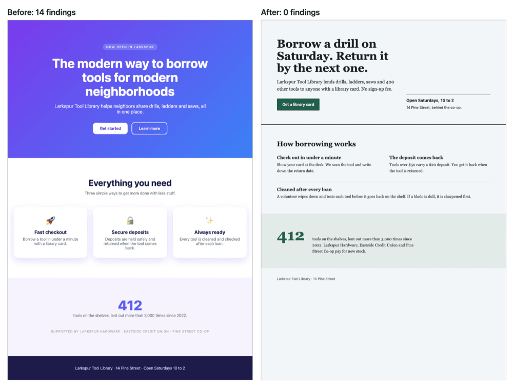
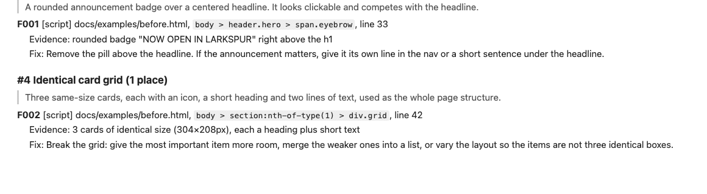
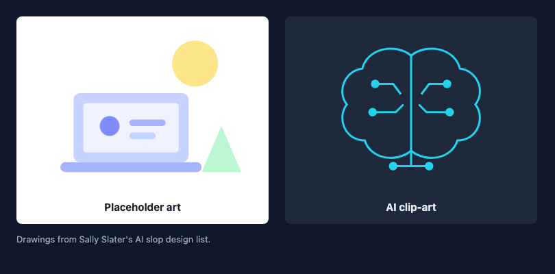

# Design Slop Check

Design Slop Check is a skill for AI coding agents. It checks an HTML page or an HTML slide deck against an exhaustive AI slop design list and writes one fix list that another agent can work through item by item. For each problem the list gives the pattern, where it is on the page, the evidence and a fix. The skill changes nothing on the page itself.

## Who it's for

People who build pages or slide decks with AI agents and want the result to not look AI-made.

## The list it is based on

The skill checks 88 patterns from [Sally Slater's AI slop design list](https://share.innovaitionpartners.com/content/ai-slop-design/). The pattern names and descriptions in `skills/design-slop-check/scripts/patterns.json` come from that list. The skill adds one check of its own, #101 (content pushed to the top or bottom of a slide), which is not on the published list.

## Install

### Claude Code (plugin)

```
/plugin marketplace add SallyRS/design-slop-check
/plugin install design-slop-check@design-slop-check
```

On Claude Code 2.1.275 or later, one line also works: `/plugin install design-slop-check --marketplace SallyRS/design-slop-check`.

### Codex (plugin)

```bash
codex plugin marketplace add SallyRS/design-slop-check
codex plugin add design-slop-check@design-slop-check
```

I copied these two commands from other Codex plugins' install instructions. I have not run them on this repo. If they don't work, use the manual install below.

### Manual install

Clone the repo, then link or copy the `skills/design-slop-check` folder into your skills folder:

```bash
git clone https://github.com/SallyRS/design-slop-check.git
mkdir -p ~/.claude/skills
ln -s "$PWD/design-slop-check/skills/design-slop-check" ~/.claude/skills/design-slop-check
```

For Codex, use the Codex skills folder instead:

```bash
mkdir -p ~/.agents/skills
ln -s "$PWD/design-slop-check/skills/design-slop-check" ~/.agents/skills/design-slop-check
```

Copying the folder works too.

### Cowork

Download `design-slop-check-cowork.zip` from the latest GitHub release and upload it to Cowork as a skill.

### What you need

- macOS or Linux. Tested on both. Windows is untested: the script only looks for Chrome in the usual macOS and Linux places, so on Windows you would have to set `CHROME_PATH`.
- Node 22 or newer.
- Chrome or Chromium that the script can start. If it can't find Chrome, set `CHROME_PATH`. Without Chrome, the layout checks don't run, and the report lists them as not checked.
- Optional: the [Impeccable](https://impeccable.style) plugin. When the script finds Impeccable's detector, it runs it and maps the results to the pattern numbers. It looks in this order: the `IMPECCABLE_BIN` environment variable, the Claude Code plugin cache, `~/.impeccable/bin/impeccable`, then your PATH. Codex users will usually need to set `IMPECCABLE_BIN`. Without Impeccable, the script runs the checks it can and says which patterns it did not check.

There is nothing to `npm install`.

## Use

Ask your agent something like "Run the design slop check on `index.html`", "slop check this deck" or "does this page look AI-generated?". The skill runs the script, the agent then looks at the screenshots to judge the patterns a script can't decide, and you get the path to `report.md`.

You can also run the script yourself. Without `--out` it writes to `./design-slop-check-report`. Run it from the folder where you cloned this repo:

```bash
cd design-slop-check
node skills/design-slop-check/scripts/check.mjs <file|folder|url> --out <report-dir>
```

It writes `report.md` (the fix list) and `report.json` (the same list for another agent to read), plus screenshots and files for the review step.

Options:

- `--mode web|slides` if it reads your file as the wrong kind
- `--viewport 1440x900` and `--slide-viewport 1600x900` to set the screen size
- `--brand "#1f5f4a,#e8b04b"` to check deck colors against your brand colors
- `--compare <old report.json>` to recheck after fixes. The new report leads with what is fixed, what is still there, and what is new.
- `--no-impeccable` to skip Impeccable's detector

Try it on the example pages in this repo:

```bash
node skills/design-slop-check/scripts/check.mjs docs/examples/before.html --out /tmp/before
node skills/design-slop-check/scripts/check.mjs docs/examples/after.html --out /tmp/after
```

## Example of what it catches

`docs/examples/before.html` is an invented page for a tool library. It has a pill label above the headline, a purple-to-blue gradient, three identical cards with emoji icons, and everything centered. With Impeccable 4.9.2, the check finds 14 items across 11 patterns. Without it, the check finds 7 items across 7 patterns. `docs/examples/after.html` is the same page fixed. The check finds nothing on it either way. Other Impeccable versions may give different counts.



The fix list for the before page starts like this (paths shortened):

```
### #2 Pill chip above the hero (1 place)

> A rounded announcement badge over a centered headline. It looks clickable and competes with the headline.

- **F001** [script] docs/examples/before.html, `body > header.hero > span.eyebrow`, line 33
  - Evidence: rounded badge "NOW OPEN IN LARKSPUR" right above the h1
  - Fix: Remove the pill above the headline. If the announcement matters, give it its own line in the nav or a short sentence under the headline.

### #4 Identical card grid (1 place)

> Three same-size cards, each with an icon, a short heading and two lines of text, used as the whole page structure.

- **F002** [script] docs/examples/before.html, `body > section:nth-of-type(1) > div.grid`, line 42
  - Evidence: 3 cards of identical size (304×208px), each a heading plus short text
  - Fix: Break the grid: give the most important item more room, merge the weaker ones into a list, or vary the layout so the items are not three identical boxes.
```



Some patterns on the list page come with drawings. Two of them are placeholder art and AI clip-art.



These are drawings from Sally Slater's AI slop design list.

## Limits

- A script can't decide 13 patterns (default hero, stock page order, mixed number formats, AI clip-art and so on). The agent judges them from the screenshots. If you run the script alone, they show as "not checked".
- Off-brand colors on decks (#79) need `--brand`. Without it, the report lists that check as not checked.
- Text baked into an image (#64), garbled text in images (#81) and approximated logos (#80) depend on reading the image, so they are judgement calls.
- Design drift between pages (#14) needs more than one page. Give the script a folder or a deck.
- The script can't read canvas charts or cross-origin images pixel by pixel, so #65 and #72 only see SVG and HTML charts and same-origin images.
- The script's layout thresholds (empty space, equal cards) are set for desktop screens. For a phone view, run with `--viewport 390x844` and expect some layout findings to change.
- The placement check (#101) needs a deck with at least 4 comparable content slides. For a smaller deck, the report lists #101 as not checked.
- The skill reads HTML pages and HTML decks only. It does not check PowerPoint, Google Slides, PDFs or images, and it does not check writing.

## Credits

- The pattern list is Sally Slater's. Some pattern descriptions are adapted (changed from the original wording) from [unslop](https://github.com/heydamir/unslop) by Damir Sokolovsky ([@heydamir](https://github.com/heydamir)), licensed [CC BY 4.0](https://creativecommons.org/licenses/by/4.0/).
- Some patterns come from [taste-skill](https://github.com/Leonxlnx/taste-skill) (v2.5.1) by Leonxlnx, licensed MIT.
- If you install [Impeccable](https://impeccable.style), the skill also runs its detector.

## License

The code is MIT, see `LICENSE`. The unslop-derived pattern descriptions stay under CC BY 4.0. The taste-skill material stays under its MIT license. Notices are in [THIRD_PARTY_NOTICES.md](THIRD_PARTY_NOTICES.md).
